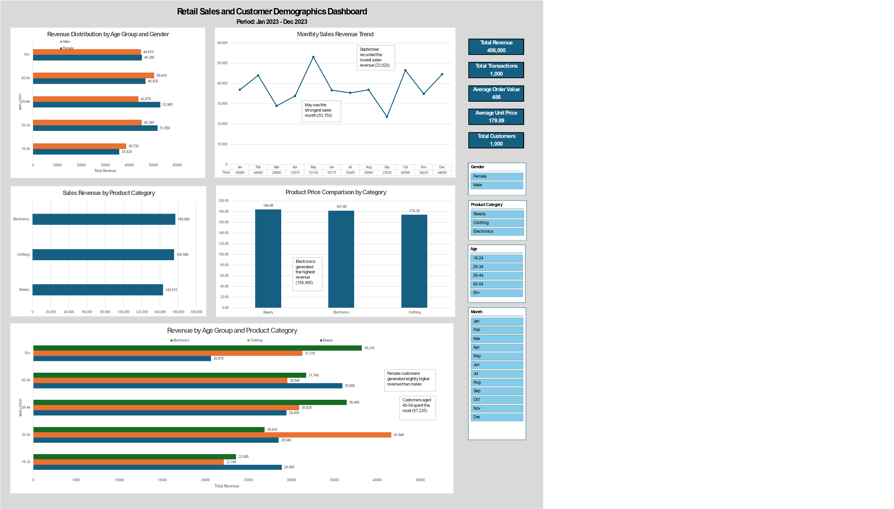

# Retail Sales and Customer Demographics Analysis

## Project Overview

This project analyzes retail sales transactions to understand customer purchasing behavior, sales trends, product preferences, and pricing patterns. An interactive Excel dashboard was developed using Pivot Tables, Pivot Charts, and Slicers to provide business insights and support decision-making.

## Tools Used

- Microsoft Excel
- Pivot Tables
- Pivot Charts
- Slicers
- Dashboard Design
- Exploratory Data Analysis (EDA)

## Dataset Information

The dataset contains 1,000 retail transactions collected between January 2023 and December 2023.

Key fields include:
- Transaction ID
- Date
- Customer ID
- Gender
- Age
- Product Category
- Quantity
- Price per Unit
- Total Amount

## Business Questions

1. How does customer age and gender influence purchasing behavior?
2. Are there discernible patterns in sales across different time periods?
3. Which product categories hold the highest appeal among customers?
4. What are the relationships between age, spending, and product preferences?
5. How do customers adapt their shopping habits during seasonal trends?
6. What insights can be gleaned from the distribution of product prices within each category?

## Key Findings

- Customers aged 45-54 generated the highest revenue (97,235).
- Female customers generated slightly higher revenue than male customers.
- Electronics generated the highest revenue (156,905).
- May recorded the highest monthly sales revenue (53,150).
- September recorded the lowest monthly sales revenue (23,620).
- Electronics achieved the highest revenue despite not having the highest average selling price.

## Dashboard Preview

## Files Included

- Retail_Sales_Dashboard.xlsx
- retail_sales_report.docx
- dashboard.png

## Skills Demonstrated

- Data Cleaning
- Data Analysis
- Data Visualization
- Dashboard Development
- Customer Segmentation
- Sales Trend Analysis
- Business Insight Generation

## Conclusion

The analysis revealed that age has a greater influence on purchasing behavior than gender, with customers aged 25-54 contributing the majority of sales revenue. Electronics emerged as the strongest-performing product category, while monthly sales analysis showed notable fluctuations throughout the year. These insights can support data-driven inventory, marketing, and customer engagement strategies.
